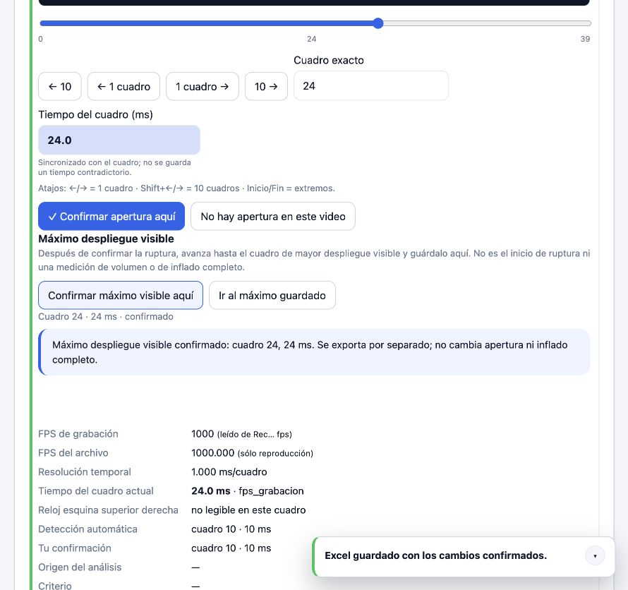
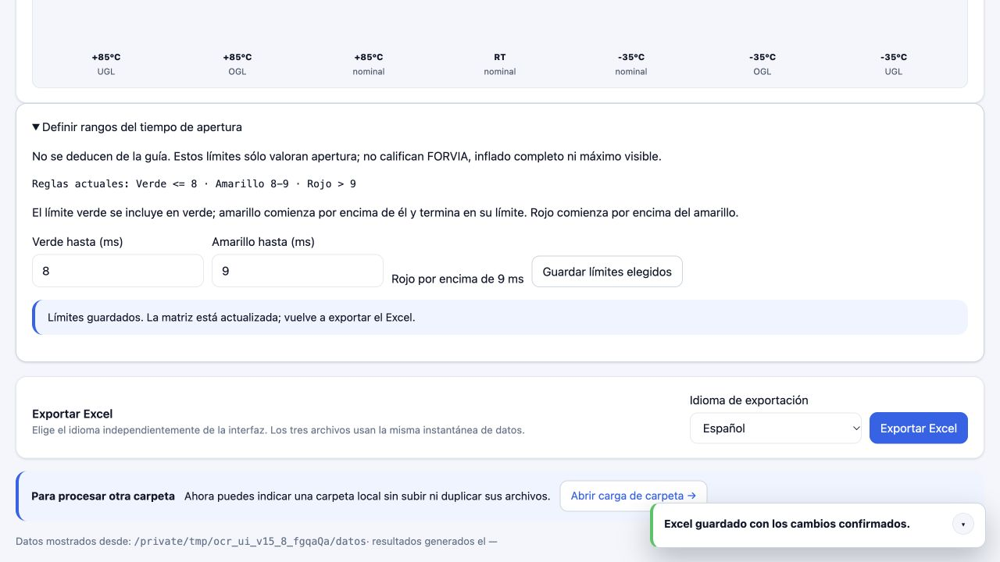

# Actualización V15.8 — cambios y validación

Fecha: 9 de octubre de 2026.

Actualización posterior: a petición del usuario, el código validado también se
aplicó a `/Users/osirissilvagarcia/proyecto_ocr`, manteniendo la rama
`ocr-v8-versuchsmatrix` y sus datos locales. La sección siguiente describe la
preparación inicial del ZIP; consulta [ACTUALIZACION_CARPETA_V15_8.md](ACTUALIZACION_CARPETA_V15_8.md) para la
aplicación al repositorio y su comprobación posterior. Sin commit ni push.

## Base correcta y conservación de datos

Se trabajó sobre una extracción independiente de
`OCR-Validacion-Excel-ocr-gpu-produccion_COMPLETO_LIMPIO_20261009_121301.zip`,
conservando sus cambios V15.7.4. No se sustituyó el repositorio anterior ni se
hizo commit o push. El ZIP recibido no contiene el directorio Git.

El paquete actualizado conserva los archivos de datos del ZIP recibido:
aprendizaje SQLite, feedback, resultados JSON, Excel y demás adjuntos. No incluye
la base de cola Excel, cachés Python ni resultados sintéticos creados al probar.
El Excel original se conserva; las columnas nuevas se generan al exportar con
esta versión, no alterando silenciosamente el libro que entregaste.

Si has seguido corrigiendo en otra instalación después de crear el ZIP original,
sus cambios más recientes no están en esta copia. Respáldalos y actualiza sólo
los archivos de código enumerados abajo; no sobrescribas sus datos o SQLite.

## Resultado implementado

- Extracción contextual basada en la guía: laboratorio frente a fabricante,
  número de prueba EDAG y semana/año, PN y niveles de ingeniería separados por
  componente, fechas ambiguas y contradictorias visibles, valores de tiempo
  sólo con etiqueta explícita. No se introducen los ejemplos de la guía como
  valores predeterminados. El perfil de fechas permanece neutral por defecto.
- Motivo/proyecto explícito, seriales con guiones, propuesta revisable del P/N ALV
  de prototipo, alertas de nomenclatura de ingeniería nueva y apertura láser del
  tablero. Se mantienen ambas etiquetas ante contradicción, sin prioridad inventada.
- Editor de rangos de apertura en Resumen: usuario elige los límites verde y
  amarillo, rojo queda por encima. Matriz/leyenda se actualizan; CLI y Excel
  comparten el feedback persistente sin sobrescribir `reglas_cumplimiento.yaml`.
- Detector orientado a ruptura localizada, clara u oscura, no sólo al
  abombamiento previo. Conserva resolución nativa, exige corroboración espacial
  y temporal, y retrocede al primer indicio continuo, incluso de un píxel en los
  casos sintéticos probados. Los candidatos automáticos siguen requiriendo
  revisión, incluido el consenso entre cámaras.
- Fotogramas del visor servidos como PNG del cuadro decodificado: sin añadir
  compresión JPEG a una evidencia mínima.
- Confirmación manual del máximo despliegue visible, independiente de apertura
  e inflado completo. Botones para confirmar el cuadro actual y volver al máximo
  guardado; reaplicación del feedback al reprocesar/exportar.
- Persistencia del máximo en `.aprendizaje/maximos_video.json`, con SHA-256 del
  archivo completo, historial, bloqueo y escritor seguro común. Un fallo de
  guardado conserva el registro anterior y se informa como fallo.
- Revisión nuevamente necesaria si cambia el vídeo, la apertura confirmada, la
  tasa real de adquisición o el origen temporal. Las revisiones completadas
  deben reabrirse para modificar el máximo.
- Excel: contrato A:AJ conservado; AK = máximo visible confirmado en ms;
  AL = revisión. Máximos incompatibles entre cámaras dejan AK vacío y muestran
  conflicto. Se añade evidencia detallada de vídeo en español, inglés y alemán.

## Pruebas ejecutadas

Entorno de validación: macOS, Python 3.12 y Node.js. Se utilizó el intérprete
local existente; no se instalaron dependencias adicionales.

| Validación | Resultado |
| --- | --- |
| Suite Python completa (`python -m pytest -q --tb=no`) | 423 aprobadas, 0 fallos |
| Scripts JavaScript (`node pruebas/*.cjs`, ejecutados individualmente) | 23 de 23 correctos |
| Compilación de los 8 módulos Python modificados | Correcta |
| Sintaxis de `app.js` e `i18n.js` | Correcta |
| Interfaz real en servidor aislado, vídeo sintético sin pérdida | Apertura confirmada en cuadro 10 y máximo en cuadro 24; apertura no cambia |
| Editor de rangos en navegador real, archivo de feedback aislado | Límites de prueba 8/9 guardados; leyenda cambia a 8/9. No se cambió la configuración del usuario |

La suite inicial del ZIP tenía 304 pruebas aprobadas y 11 fallidas. Los fallos
preexistentes se debían a fixtures históricas que el ZIP ya no trae y a
comprobaciones estáticas de versiones/controles antiguos. Los tests se
actualizaron para crear datos temporales explícitos y comprobar los controles
vigentes, sin saltarlos ni reducir las aserciones. También se corrigió el test
que antes exigía reproducir el falso positivo por abombamiento.

Las pruebas nuevas cubren: guía/contextos y conflictos; ruptura mínima clara y
oscura, ruido, movimiento y retroceso; consenso todavía revisable; máximos y
exportación multilingüe; PermissionError transitorio y persistente; conservación
del checkpoint de feedback anterior; vídeos movidos/modificados; invalidación
temporal; bloqueos de API durante procesamiento/revisión completada; cuadros
fuera de rango; fidelidad PNG. La suite completa incluye las pruebas existentes
de persistencia, progreso, pausa y cancelación.
Se incluyen contradicciones de máximo con vídeos offline, invalidación de otra
cámara, umbrales con fronteras exactas/decimales, historial, rechazos y escrituras
bloqueadas. Los límites de prueba 8/9 no se incluyen como datos en el paquete.

Única advertencia de la suite: deprecación Starlette/httpx del entorno de
pruebas. No se ocultó ni se modificaron dependencias para eliminarla.

## Correspondencia con las observaciones de la guía

| Observación | Aplicación / límite |
| --- | --- |
| Semana/año/prueba EDAG; proyecto también como motivo | WWYYNN sólo con contexto EDAG; contraste con fecha; motivo desde proyecto/pizarra explícitos, no desde un identificador interno |
| EDAG frente a laboratorio VW | Prefijo VW de prueba distinguido de VW AG fabricante; datos procedentes de imágenes/capturas OCR o corrección explícita |
| Ingeniería de prototipo | 02S/69K/03S según componente; nomenclatura nueva etiquetada se propone con revisión |
| Delay y uno/dos pasos | Sólo valor de delay explícito o manual. El número de pasos no se inventa desde tipo de generador; falta catálogo aprobado |
| Usar ambas etiquetas | Corroboración del mismo campo por varias fuentes; desacuerdo conserva ambas y muestra conflicto |
| Corroborar módulo y tablero | Campos/evidencias separados; no equiparar PN, fechas o ingeniería de piezas distintas. Homologación automática pendiente de catálogo compatible |
| Apertura láser y alerta de ingeniería del tablero | Propuesta explícita con revisión propia; no inferida del PN ni del tiempo de apertura |
| Rangos verde/amarillo/rojo elegidos por el usuario | Editor en Resumen, persistencia local e iguales reglas en matriz/CLI/Excel; no copiar estos límites a FORVIA o inflado completo |

## Archivos de producto modificados

- `config.yaml`: perfil de extracción opcional, neutral por defecto.
- `configuracion.py`: carga común de los criterios explícitos del usuario.
- `criterios_usuario.py` (nuevo): límites persistentes con validación e historial.
- `flujo_empresarial.py`: reglas y trazabilidad según guía; versión de parser.
- `validacion.py`: contexto del perfil y reaplicación del máximo persistente.
- `video_airbag.py`: ruptura nativa, corroboración y revisión del consenso.
- `maximos_video.py` (nuevo): feedback durable e independiente de los máximos.
- `reporte_bmg.py`: máximo y revisión, evidencia multilingüe y reglas de fuente.
- `dashboard/backend/app.py`: endpoint de máximo y cuadros PNG.
- `dashboard/frontend/app.js`: confirmación/navegación del máximo y textos claros.
- `dashboard/frontend/estilos.css`: presentación del bloque de máximo.
- `dashboard/frontend/i18n.js`: traducciones de los controles nuevos.
- `dashboard/frontend/index.html`: actualización de recursos del navegador.
- `VERSION.txt`, `README.md`: versión y acceso a instrucciones actualizadas.

Nuevos tests: `test_guia_etiquetas.py`, `test_ruptura_real.py`,
`test_maximos_video.py`, `test_reporte_tiempos_video.py`,
`test_criterios_usuario.py`, `test_v15_8_guia_ui.cjs`.

Tests existentes ajustados en `pruebas/`: `test_dashboard.py`,
`test_excel_textos.py`, `test_v15_6_tiempo_video_estable.py`,
`test_v15_7_2_controles_video.py`, `test_v15_7_3_video_supervision.py`,
`test_v15_7_4_nacimiento_preciso.py`, `test_v15_7_detector_apertura.py`,
`test_v14_15_1_i18n_restante.cjs`, `test_v14_15_editor_bloque_i18n.cjs`,
`test_v15_video_ui.cjs`.

Documentación nueva: este informe, [LEEME_V15_8_GUIA_RUPTURA_MAXIMO.md](../guias/LEEME_V15_8_GUIA_RUPTURA_MAXIMO.md) y captura
de las pruebas aisladas en `docs/v15_8_maximo_confirmado_prueba.jpg` y
`docs/v15_8_rangos_prueba.jpg`.

## Límites y pendientes reales

- Falta validar con vídeos reales etiquetados de tus cámaras. No hay porcentaje
  de exactitud real medido ni garantía de detectar cualquier píxel comprimido,
  ruido, reflejo u oclusión. Las pruebas sintéticas no sustituyen esa medición.
- Falta ejecución nativa en Windows 11 / RTX A3000. Los bloqueos de Windows se
  simularon con PermissionError; no se afirma una prueba física de esa GPU.
- Resolución nativa puede aumentar CPU/RAM: no se promete acelerar el análisis.
  Se mantiene parada temprana y buffer acotado; el máximo manual no agrega una
  segunda pasada automática a todos los vídeos.
- El máximo visible se confirma manualmente: no es una estimación automática
  de volumen ni demuestra inflado completo. Los FPS deben ser de adquisición,
  no reproducción, y el origen temporal del ensayo debe estar establecido.
- No se entrenó EasyOCR ni se usaron nube/APIs externas. Guardar una corrección
  o un máximo no significa entrenar un nuevo modelo neuronal.
- La guía no aporta catálogo de homologación módulo/tablero ni límites de
  aceptación aprobados. No se inventaron esas relaciones. El usuario debe
  seleccionar sus límites y aportar las combinaciones válidas si quiere
  automatizar esa homologación.

Consulta [LEEME_V15_8_GUIA_RUPTURA_MAXIMO.md](../guias/LEEME_V15_8_GUIA_RUPTURA_MAXIMO.md) antes de instalar/exportar.
